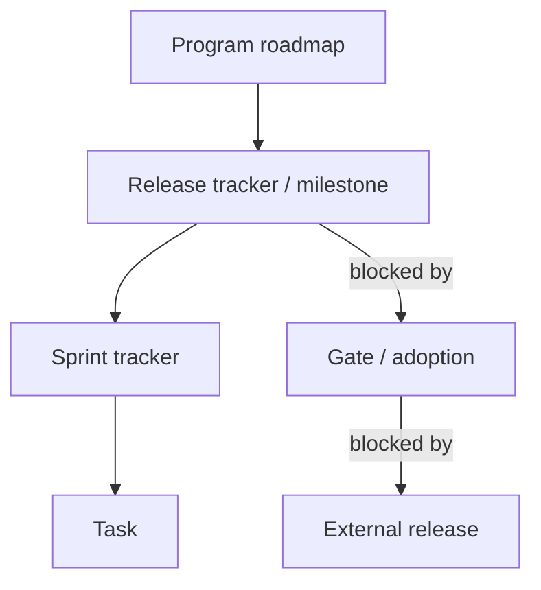
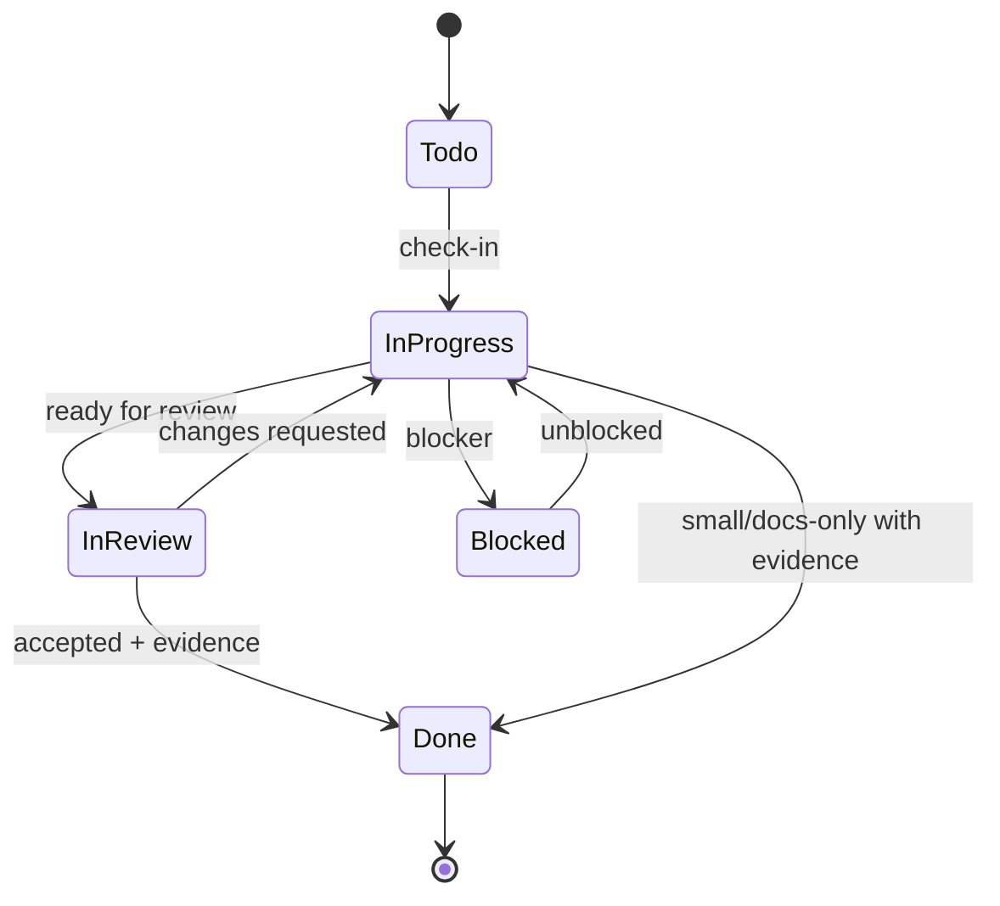

# HOW TO USE — exhaustive handbook

**Docs version:** v1.2.2-docs.1 · Target template: v1.2.2
**Audience:** humans and agents setting up or operating a GitHub project tracker.
**Companion docs:** [Quickstart](./QUICKSTART.md) · [Reference](./REFERENCE.md) · [Troubleshooting](./TROUBLESHOOTING.md) · [Adoption](./ADOPTION.md) · [Agent guide](./AGENT_GUIDE.md) · [Playbook](./GITHUB_PROJECT_TRACKER_PLAYBOOK.md)

> **Availability:** bootstrap, audit, task CLI, CI/security workflows, and release profiles are implemented. This handbook documents both manual GitHub UI + `gh` paths and the CLIs; planned contracts are labeled.

## Contents

1. [Mental model](#1-mental-model)
2. [Roles](#2-roles)
3. [Prerequisites and auth](#3-prerequisites-and-auth)
4. [Set up a new tracker](#4-set-up-a-new-tracker)
5. [Configure fields, views, workflows](#5-configure-fields-views-workflows)
6. [Read the board](#6-read-the-board)
7. [Find work and Definition of Ready](#7-find-work-and-definition-of-ready)
8. [Task check-in](#8-task-check-in)
9. [During work](#9-during-work)
10. [Review and check-out](#10-review-and-check-out)
11. [Sprint lifecycle](#11-sprint-lifecycle)
12. [Release lifecycle](#12-release-lifecycle)
13. [Audit](#13-audit)
14. [Downstream feedback](#14-downstream-feedback)
15. [Worked end-to-end example](#15-worked-end-to-end-example)
16. [GUI, shells, multi-project](#16-gui-shells-multi-project)
17. [Change protocol](#17-change-protocol)
18. [Glossary](#18-glossary)

---

## 1. Mental model



- **Program** — long-lived stream with its own repo/board/versions. One tracker repo can host one program; multiple projects can share a tracker as downstreams.
- **Release** — a versioned milestone + release tracker issue; gates/artifacts/rollback.
- **Sprint** — a scoped build unit inside a release; issue-backed, not a calendar box.
- **Task** — one verifiable unit, one owner, one branch, one PR.
- **Gate/adoption** — an issue that blocks program work until an upstream dependency is resolved.

Rules that never change: one task → one branch → one PR; one In Progress task per owner; explicit check-in/out; fields are authoritative over labels; no secrets in the repo.

## 2. Roles

| Role | Responsibility | Does not |
|---|---|---|
| Owner | starts task, posts check-in/out, keeps status current, produces evidence | silently expand scope; leave WIP unrecorded |
| Executor (human or agent) | performs the work under the same owner identity | self-merge without evidence; bypass gates |
| Reviewer | checks acceptance/evidence/quality; sets In Review → Done | rewrite history; close without evidence |
| Maintainer | triage, sprint/release close, audit exceptions, tokens/permissions | bypass security rules |
| Downstream maintainer | reports upstream, tracks upgrade, pins exact version | fork silently |

One owner = one identity. If a human delegates to an agent, the check-in records `Owner:` and `Executor:` separately.

## 3. Prerequisites and auth

### 3.1 Tools

```bash
gh --version
# gh version 2.x.x (...)
node --version
# v22.x.x (required for CLI/automation; optional for UI path)
git --version
# git version 2.x.x
```

### 3.2 Authenticate `gh`

```bash
gh auth status
# github.com
#   ✓ Logged in to github.com account <you> (...)
#   - Token scopes: 'repo', 'project', ...
```

If `project` is missing:

```bash
gh auth refresh -s project
# opens browser verification; then:
gh auth status
```

Expected failure: `error: your authentication token is missing required scopes` → run the refresh command above. See [Troubleshooting](./TROUBLESHOOTING.md#auth-and-project-scope).

### 3.3 Permissions

- Repo: Issues write; Projects write (or project owner).
- Project-scoped token for audit/reusable workflows: least privilege; store as a secret, never in config.
- Org repos may require SSO authorization: `gh auth refresh -s project,repo` and authorize the org.

### 3.4 Platform notes

- **macOS/Linux:** bash/zsh snippets apply.
- **Windows:** use Git Bash/WSL; PowerShell equivalents are listed in [Reference](./REFERENCE.md#17-shell-notes).
- **GUI-only steps:** labels/types/workflows/branch protection may require Settings UI; UI descriptions are included.

## 4. Set up a new tracker

### 4.1 Create repo/project

1. Create/reuse repo; enable Issues + Projects.
2. Create the project (Table layout) and link it to the repo.
3. Authenticate `gh` with `project` scope.

```bash
gh repo create OWNER/REPO --private --add-readme --clone
cd REPO
gh project create --owner @me --title "Project Tracker"
# https://github.com/users/OWNER/projects/1
gh project link PROJECT_NUMBER --owner @me --repo OWNER/REPO
```

Org project alternative: `--owner ORG`.

### 4.2 Create milestones (releases)

UI **Issues → Milestones → New milestone**. CLI:

```bash
gh api repos/OWNER/REPO/milestones -f title="v0.1.0" -f description="First release"
# {"number":1,"title":"v0.1.0",...}
```

### 4.3 Create the hierarchy

Create release tracker, then sprint tracker(s), then tasks.

- Release tracker body: objective, sprint scope, gates, risks/rollback, artifacts/versioning.
- Sprint tracker body: goal, task links, exit criteria, estimate.
- Link native sub-issues (UI **Sub-issues** panel; or API).

```bash
PARENT_ID=$(gh api repos/OWNER/REPO/issues/1 --jq .id)
CHILD_ID=$(gh api repos/OWNER/REPO/issues/2 --jq .id)
gh api repos/OWNER/REPO/issues/1/sub_issues -X POST -F sub_issue_id="$CHILD_ID"
# 201 Created (no body)
```

Expected UI: task appears under parent; parent progress shows `1/1`.

### 4.4 Install templates/config

- Copy `.github/ISSUE_TEMPLATE/*` and `PULL_REQUEST_TEMPLATE.md`, plus `scripts/github/**`, `schemas/tracker.config.schema.json`, and `package.json` from the tracker template (copy mode requires the full set).
- Copy `tracker.config.example.json` to `tracker.config.json`; edit values.
- Validate:
  ```bash
  node scripts/github/validate-config.mjs tracker.config.json
  # OK   tracker.config.json
  ```
- Pin `automation.templateVersion` exactly and keep `feedback`/`governance` sections.

### 4.5 Issue types and fallback

Enable native types Task/Bug/Feature (Settings → Issues → Types). If unavailable:

- Document the fallback (e.g., project `Kind` field).
- Do not create type labels when native types exist.
- Audit should exempt only the documented fallback.

## 5. Configure fields, views, workflows

### 5.1 Fields

| Field | Type | Options |
|---|---|---|
| Status | single select | Todo, In Progress, In Review, Blocked, Done |
| Release | single select | version keys |
| Sprint | single select | sprint keys |
| Area | single select | stable areas |
| Kind | single select | feature, fix, ux, spike, test, infra |
| Estimate | single select | S, M, L (or numeric; pick one) |
| Source | single select | Internal, `<downstream>`, Other |

Create via UI (**Project → Settings → Custom fields**) or `gh project field-create`.

Discover IDs/options:

```bash
gh project field-list PROJECT_NUMBER --owner @me --format json
# {"fields":[{"id":"PVTSSF_...","name":"Status","options":[{"id":"...","name":"Todo"}]}]}
```

### 5.2 Statuses and transitions



- Only In Progress/In Review/Blocked are active; Done requires evidence.
- Do not use labels as the authoritative status.

### 5.3 Views

| View | Filter/group | Use |
|---|---|---|
| In flight | Status is In Progress/In Review/Blocked | daily work |
| Current sprint | Sprint = current, hide Done | sprint stand-up |
| Roadmap | group by Release | scope/sequencing |
| Blocked | Status = Blocked | unblocking |
| Release readiness | group by Release; progress | release gates |
| Recently done | Done sorted by closed | review/evidence |
| Downstream | Source = downstream | feedback intake |

UI-only steps: create view, choose layout/filter/group, save. CLI/API view creation exists but filters are limited; GUI is authoritative here.

### 5.4 Project workflows

Enable built-in workflows (Project → ⋯ → Workflows):

- Auto-add issues from the repo.
- Issue closed → Status Done.
- Do **not** auto-start work; check-in is explicit.

### 5.5 Labels (minimal)

Only process/risk labels: `risk:low|medium|high`, `plan-change`, `source:downstream`, `status:needs-triage`. Do not add area/release/sprint/type labels.

## 6. Read the board

1. Open the project **In flight** view: active work first.
2. Check **Blocked** if work is stalled.
3. Check **Current sprint** for scope; compare child issue states in the sprint tracker.
4. Check **Roadmap** for release-level sequencing.
5. If fields and labels disagree, fields/type/milestone win.

Text snapshot (sanitized):

```
Status      Release  Sprint   Title
In Progress v1.0.0   1.0.0.2  [Task] Add audit script
Blocked     v1.0.0   1.0.0.2  [Task] Token setup
Done        v1.0.0   1.0.0.1  [Task] Add playbook
```

## 7. Find work and Definition of Ready

Only start a task when:

- [ ] Problem/goal/non-goals are clear.
- [ ] Acceptance criteria are testable.
- [ ] Test/evidence plan named.
- [ ] Dependencies/blockers linked.
- [ ] Estimate, Release, Sprint, Area, Kind fields set; Source if downstream.
- [ ] Native type + no unresolved blocker.
- [ ] Tooling profile: open `[Stream]` container exists, the task is its sub-issue, and the same
      `Stream` option is set on the task; Release/Sprint/milestone are not required.

If not ready, set **Todo** and comment what is missing; do not start.

## 8. Task check-in

1. Assign yourself (owner).
2. Status **In Progress**.
3. Post the check-in template (see [check-in](./comment-templates/check-in.md)).
4. Create branch `task/<issue>-<slug>` from main.
5. Push a draft/early PR with `Refs #<issue>`; use `Closes` only when it completes the issue.
6. Confirm WIP = 1.

CLI status update:

```bash
gh project item-edit --id ITEM_ID --project-id PROJECT_ID \
  --field-id STATUS_FIELD_ID --single-select-option-id IN_PROGRESS_OPTION_ID
# (no output on success)
```

Expected issue comment after check-in:

```
### Check-in
- **Owner:** ...
- **Executor:** human:... | agent:...
- **Branch:** task/123-...
...
Status → In Progress.
```

If you cannot start: leave Todo or set Blocked with a reason; don't create orphan branches.

## 9. During work

- Commit with issue references: `task(#123): fix ...`.
- Post update comments at meaningful boundaries (done/next/blockers/scope/evidence).
- Keep status current: In Progress → In Review only when ready for review; Blocked only with concrete reason + dependency.
- **Session end without completion:** post a checkpoint (state/next/branch/PR) and keep status accurate. No silent WIP.
- **Scope change:** dated `plan-change` comment, label, update sprint/release/project fields, defer equivalent scope.
- **Remote-only suites:** never run a declared visible GUI suite locally. Use
  `npm run guard:local-suite -- --suite <id>` before spawning (or the hidden wrapper); local
  `--mode report` records `DEFERRED_REMOTE`, and the remote visible run is the evidence. The
  override env is for deliberate human debugging only; agents must not set it.
- **Verified counts:** when `docs.counts` is configured, run the counted inventory and
  `suite-counts check`; counts change ⇒ baseline + `docs/TEST_COUNTS.md` + markers change in the
  same PR (`docs:counts:update`, then complete skip/review agreement). `guard:docs:counts` must pass.

```bash
git add -A
git commit -m "task(#123): implement change"
git push -u origin task/123-change
```

## 10. Review and check-out

Reviewer checks:

- [ ] Acceptance criteria/evidence.
- [ ] Required checks pass; test plan executed.
- [ ] Remote-only suites: remote run/artifact evidence attached; hidden local runs not cited as evidence.
- [ ] Counts evidence: `COUNTS_OK` from the counted inventory (when `docs.counts` is configured), not remembered numbers.
- [ ] No secrets/live calls; docs updated.
- [ ] One task/one PR.
- [ ] Deviations/follow-ups recorded.

Check-out flow:

1. PR ready; attach evidence; status **In Review**.
2. Reviewer approves or requests changes.
3. Merge with `Closes #<issue>` (or close manually with reason).
4. Set status **Done**; confirm issue closed.
5. Post [check-out](./comment-templates/check-out.md), including tests/evidence/deviations.
6. Update parent sprint/release if exit criteria affected.

Tooling profile: use `task.mjs done --issue N --pr <PR> --evidence "..."` — the PR is required, and
the audit flags closed tooling tasks without a `### Check-out` comment. `[Stream]` containers are
closed by `stream.mjs close`, never by a PR closing keyword.

```bash
gh pr merge --squash --delete-branch
# ✓ Merged pull request #...
```

## 11. Sprint lifecycle

### Kickoff
- Confirm all tasks pass DoR; link dependencies.
- Set sprint tracker In Progress; announce goal/tasks/risks.
- Verify parent release tracker.

### During
- Track progress via child issues; update sprint only for blockers/deferrals/scope changes.
- Keep WIP = 1.

### Close
- All children Done or explicitly deferred (`plan-change`).
- Post [sprint-close](./comment-templates/sprint-close.md) with demo/evidence.
- Close sprint issue; update parent release tracker.

Acceptance: no Done sprint with open children unless deferral is recorded.

## 12. Release lifecycle

### Kickoff
- Release tracker In Progress; scope/sprints/gates/rollback/artifacts confirmed.
- Required checks and tokens ready; dry-run defaults documented.

### During
- Update release tracker at each sprint close: completed scope, risks, decisions, estimate changes.
- Do not duplicate sprint status.

### Close
- Every gate checked with evidence.
- Tag matches versions; build/publish artifacts + checksums.
- Release notes/docs updated; release tracker + milestone closed; final summary posted.
- Do not close with open child sprints unless deferred.

### Tooling profile: Stream → Task deliveries

Repos with `"workProfile": "tooling"` replace the release/sprint hierarchy with unversioned
`[Stream]` containers; the tag (if any) is the version record.

```bash
# open a delivery container (appends the per-delivery Stream option safely)
node scripts/github/stream.mjs open --name v1.3.1 --delivery "Documentation & maintenance"

# start a task inside it (task must be a sub-issue with the same Stream option)
node scripts/github/task.mjs start --issue 123 --stream 120 --owner presljf

# check out with PR + evidence, then close the container after every child task is done
node scripts/github/task.mjs done --issue 123 --pr https://github.com/OWNER/REPO/pull/45 --evidence "npm test 137/137"
node scripts/github/stream.mjs close --stream 120 --evidence "release gate green" --tag v1.3.1
```

`close` refuses while child tasks are open, requires the release gate green, records
`### Stream close evidence`, and validates the tag against `automation.tagPattern`. See
[profiles/tooling](../profiles/tooling/README.md).

## 13. Audit

Run `node scripts/github/audit.mjs --config tracker.config.json --advisory` (or `--strict` for release gates).

Checklist:
- [ ] Open release issues have milestone + type.
- [ ] Project fields complete (Release/Sprint for release work; Area/Kind/Estimate; Source for downstream).
- [ ] No parent Done with open children without deferral.
- [ ] No In Progress without assignee + check-in.
- [ ] WIP ≤ 1 per owner (or documented exception).
- [ ] Blocked has reason + dependency link.
- [ ] No duplicate/retired labels.
- [ ] Sprint/release Done has exit evidence (product profile); closed stream has `### Stream close evidence`
      and closed tooling tasks have `### Check-out` evidence (tooling profile).
- [ ] Template version pinned; downstream issues have origin/version/context.
- [ ] No secrets in config/artifacts (manual review; audit does not scan comments).
- [ ] Open tasks have required DoR sections and profile-correct tracker ancestry (release+sprint for
      product, `[Stream]` for tooling) and profile-correct fields.

Enforcement: advisory in CI first; required at release gates once stable. Audit token is project-scoped and stored as a secret.

## 14. Downstream feedback

If you adopted the tracker, you are downstream:

- Report bugs/features **upstream** with the downstream forms; include origin/version/environment/repro/expected/actual/impact/workaround/link.
- Never fork silently; document temporary workarounds with an upstream issue link.
- Versioning: patch/minor/major; pin an exact tracker version; upgrade explicitly.
- Triage sets Source/labels/type/fields; best-effort/no SLA.
- Security issues go through the private channel; never public.

See [Downstream feedback](./DOWNSTREAM_FEEDBACK.md) and the [reporting card](./reference-cards/reporting-upstream.md).

## 15. Worked end-to-end example

Sanitized scenario: docs task with review.

1. **Create sprint/task** with bodies/acceptance; link task under sprint.
2. **Check in:**
   ```bash
   git checkout -b task/123-add-guide
   # post check-in template; status In Progress
   ```
3. **Work:** write `docs/guide.md`; commit/push; early PR `Refs #123`.
4. **Update:** comment progress + evidence; status In Review once PR is ready.
5. **Review:** reviewer checks links, commands, acceptance; requests a fix; owner pushes; checks rerun.
6. **Check out:** merge `Closes #123`; status Done; post check-out with `npm test`/link-check output.
7. **Sprint close:** all tasks Done; post exit/demo; close sprint; update release tracker.
8. **Release close:** gates/artifacts/tag; release notes; close tracker/milestone.

Expected evidence in check-out:

```
- Tests: link-check PASS; docs build PASS
- Evidence: PR #45; files docs/guide.md...
- Deviations: none
```

## 16. GUI, shells, multi-project

- GUI: everything can be done in the GitHub UI; commands here are convenience/automation paths. UI-only steps: issue types, field option editing, view filters, branch protection, project workflows.
- **macOS/Linux:** snippets apply.
- **Windows:** use Git Bash/WSL; PowerShell equivalents in [Reference](./REFERENCE.md#17-shell-notes).
- **Multiple projects:** see [MULTI-PROJECT](./MULTI_PROJECT.md). Use separate boards by default; Source field for downstream; cross-repo dependencies/gates for sequencing.

## 17. Change protocol

For any scope/acceptance/estimate/gate change:

1. Dated `plan-change` comment (old → new, why).
2. Label `plan-change`.
3. Update sprint + release trackers.
4. Update Project fields.
5. Defer equivalent scope or create follow-up.
6. Never rewrite history.

Template: [plan-change](./comment-templates/plan-change.md).

## 18. Glossary

- **DoR/DoD:** Definition of Ready/Done.
- **Check-in/out:** explicit start/finish record with owner/evidence.
- **WIP:** in-progress work; one task per owner.
- **Gate:** issue that blocks program work until an upstream dependency resolves.
- **Downstream:** project that adopted the template; reports upstream.
- **Plan of record:** GitHub issues/fields/milestones; chat is context.

**Next:** [Reference](./REFERENCE.md) for every command/field/token; [Troubleshooting](./TROUBLESHOOTING.md) for failures; [Adoption](./ADOPTION.md) to onboard a project.


## Lint/format self-check (T18)

Tracker OS now self-applies ESLint and Prettier: `npm ci`, `npm run lint`, and
`npm run format:check`. A missing or broken lint/format command fails CI rather than succeeding
as a no-op. Dev tooling is approved in `tracker.dependencies.json`; see issue #82.
